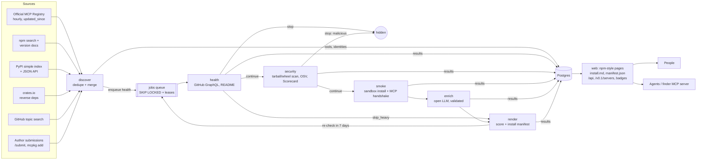

# Architecture

## Overview

One Go binary (`mcpkg`) has every role. Postgres is the only stateful component. It holds the catalog, the job queue, the audit trail and the review queue.

| Process | Command | Where it runs |
|---|---|---|
| Web + API | `mcpkg serve` | core box |
| Scheduler | `mcpkg scheduler` (one per deployment) | core box |
| Light worker | `mcpkg worker -stages health,enrich,render` | core box |
| Heavy worker | `mcpkg worker -stages security,smoke` | spot boxes (or core) |
| Finder | `mcpkg finder -api https://…` | user's machine (agent) |

## Pipeline and gates

Each stage is a hook that returns a **decision**:

| Decision | Meaning |
|---|---|
| `continue` | enqueue the configured `next` stage |
| `skip_heavy` | jump to `render` (skip security, smoke, enrich): archived repos, unchanged re-checks |
| `stop` | end here; with `status=blocked` the tool is hidden |

Stages are ordered cheapest first, so expensive work only runs on tools that survive the cheap checks:

| # | Stage | Cost | Executes untrusted code? | Gate examples |
|---|---|---|---|---|
| 1 | health | API calls (25 repos per GraphQL call) | no | repo missing + nothing to install → stop; archived → skip_heavy; unchanged since last full check → skip_heavy |
| 2 | security | download + regex/semgrep/osv | no | OSV `MAL-*` or registry takedown → stop + hide; high findings → review |
| 3 | smoke | 1–3 min container time | **yes, sandboxed** | always continue; results feed the score |
| 4 | enrich | ~2k tokens of a small open model | no | always continue (fallback text if the LLM fails validation) |
| 5 | render | ms | no | schedules the next re-check |

Script hooks (`pipeline.json → hooks`) run after any stage. They can only make a decision stricter. See [HOOKS.md](HOOKS.md).

**Re-checks.** `render` schedules `health` again in `recheck.health_every_days` (7). `health` compares the head commit and version with the last full check. If nothing changed within `skip_unchanged_within_days` (30), it returns `skip_heavy`, so weekly re-checks cost API calls, not containers. A new version found by discovery always re-runs everything.

**Priority.** Jobs carry `priority = stars + weekly_downloads/100`. Popular tools are verified first. If the budget runs out mid-pass, only the long tail waits.

## Queue semantics

- `INSERT … ON CONFLICT DO NOTHING` on a partial unique index means at most one active job per (stage, tool). Re-enqueueing is idempotent.
- `Claim` = `UPDATE … WHERE id IN (SELECT … FOR UPDATE SKIP LOCKED)` with a lease. Any number of workers on any number of machines can claim safely.
- Failures retry with backoff of 1, 4, 16 … minutes, up to 6 h. After `max_attempts` a job is `dead` (visible in `mcpkg stats`).
- Rate limits (GitHub 403/429 with reset headers) re-queue without burning an attempt.
- A worker that crashes or loses a spot instance leaves expired leases. The reaper returns those jobs to the queue. Every stage is idempotent.

## Dedupe

Each candidate yields identity keys: `registry:<name>`, `npm:<pkg>`, `pypi:<pep503>`, `oci:<image>`, `crate:<name>`, `remote:<url>`, and `repo:<host/owner/repo[#subfolder]>`.

- Package, registry and remote keys, and repo keys with a subfolder, are **strong**: a match means the same tool.
- A bare repo key is **weak**, because one monorepo hosts many servers. It merges only when that can't collide (for example a GitHub-search hit with no package, or a repo that doesn't already map to another package in the same ecosystem).
- When strong keys point at two tools, they are merged.
- Each source's view is stored under `tools.sources[<source>]`. Public fields are recomposed by precedence: registry > npm/PyPI > crates > GitHub > submit. Re-crawls are idempotent. Slugs never change.

## Data model (Postgres)

| Table | Purpose |
|---|---|
| `tools` | one row per server; JSONB columns `health`, `security`, `smoke`, `enrich`, `score`, `install`; generated `tsvector` for search |
| `identities` | dedupe keys → tool |
| `jobs` | queue (stage, tool, state, attempts, lease, priority) |
| `check_runs` | audit trail of every stage/hook run (Health tab "Check history") |
| `review_queue` | human QA: sampled LLM text, high findings, blocks |
| `submissions` | author links (rate-limited per network) |
| `source_cursors` | incremental crawl state + scheduler last-run times |

Search uses Postgres full-text (`websearch_to_tsquery`) plus `pg_trgm` similarity on names, ranked by text relevance × trust score. Semantic search (pgvector) is a Phase 3 item.

## Smoke test in detail

1. `launch.Choose` picks the method from metadata, never by guessing. Order: npm stdio > PyPI stdio > OCI > remote. Source-only repos and Rust crates are `skipped` with a reason.
2. Required env vars and arguments get placeholders (`mcpkg-smoke-placeholder`, a writable dir for paths). Optional ones stay unset.
3. **Install phase** runs in a container on an internal network whose only exit is a Squid allowlist (npm, PyPI, GitHub).
4. **Run phase** uses a fresh container: `--network none --read-only --cap-drop ALL --pids-limit 256 --memory 1g`, optional `--runtime runsc` (gVisor), package volume mounted read-only.
5. The MCP client does `initialize` → `notifications/initialized` → `tools/list` (paginated), plus prompt and resource counts. It never calls a tool.
6. Classification is code: `works` | `needs_credentials` (exited or errored with key/token messages) | `auth_required` (HTTP 401/403) | `broken` | `install_failed` | `skipped`.
7. Tool names and descriptions from the live `tools/list` are scanned for prompt injection and hidden Unicode (tool poisoning).

## Security

| Threat | Mitigation |
|---|---|
| Malicious package runs code on our infra | Only in the smoke stage, in disposable containers, with no runtime network, no capabilities, read-only FS, optional gVisor. Workers are separate spot boxes in their own security group. |
| Data exfiltration during install | Install phase can reach only the registries allowlist (Squid). Run phase has no network. |
| Credential theft from the host | Sandboxes get no host env (scrubbed), no Docker socket, no IMDS (hop limit 1, internal network). Secrets live only in `.env` on the core box. |
| SSRF via "remote" URLs | Dialer refuses loopback, private, link-local, CGNAT and metadata IPs after DNS resolution. No proxy. Max 3 redirects. |
| Prompt injection into our LLM | README is passed as data. Output is schema-validated and grounding-checked (URLs, tool names, no commands). The LLM has no authority over scores or install steps. |
| Tool poisoning targeting users' agents | Live tool descriptions are scanned. Findings cap the score at 40 and open a review. `install.md` tells agents that descriptions are untrusted. |
| XSS via READMEs | goldmark renders without raw HTML. `javascript:` links and plain-http images are dropped. Strict CSP, `nosniff`, frame deny. |
| Zip slip / zip bombs | Safe extraction: path checks, file-count and byte limits, links skipped. |
| Abuse of /submit | Rate limit per hashed client IP (10/hour). Only https endpoints accepted. |
| Admin CSRF | Basic auth plus same-origin check on POST. |

## Scaling notes

| Scale | Setup |
|---|---|
| Up to ~100k tools | Postgres on the core box is plenty (catalog < 5 GB, mostly READMEs). |
| More throughput | Add spot workers: `deploy/aws/launch.sh worker`. They need only `DATABASE_URL`. |
| More web traffic | Put a CDN in front (pages are cacheable). The web process is stateless. Run more `serve` replicas. |
| Bigger | Move Postgres to RDS. Move README blobs to S3 if the table grows past ~20 GB. |
